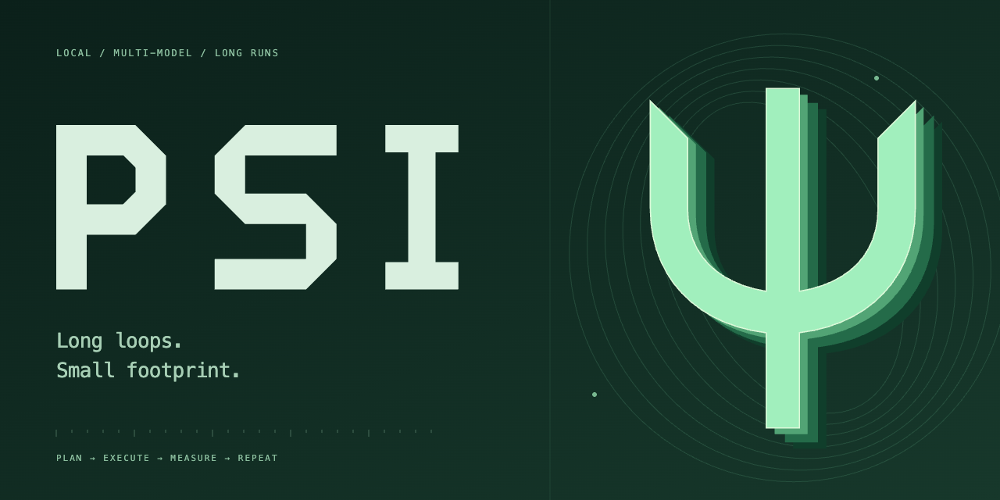

<p align="center"><a href="https://github.com/sebastianmiletic/Psi/releases/latest"></a></p>

<p align="center">
  <a href="https://github.com/sebastianmiletic/Psi/actions/workflows/verify.yml"></a>
  <a href="https://github.com/sebastianmiletic/Psi/releases/latest"></a>
  
</p>

<p align="center"><strong>Lightweight AI harness made for long and intensive loops.</strong><br>Local execution. Multiple accounts. Durable progress.</p>

<p align="center"><a href="https://github.com/sebastianmiletic/Psi/releases/latest">Download</a> · <a href="docs/GUIDE.md">Guide</a> · <a href="docs/BATTLECODE_WORKFLOW.md">Battlecode</a> · <a href="docs/HARNESS_BENCH.md">Benchmarks</a></p>

## One terminal, the whole loop

Psi connects models, project files, build tools, browser research and experiments in one local terminal. Set an objective, choose how much reasoning to use, and keep the evidence across sessions.


| | |
| :--- | :--- |
| **Persistent goals** | Recover through provider failures and quota waits. Resume the journal after an interruption. |
| **Accounts that travel with the task** | Multiple providers and multiple accounts per provider, reported quotas and optional failover. |
| **Subagents on demand** | Independent roles, models and effort. Turn on OVERKILL from `/effort`. |
| **Tools in your workspace** | Read, edit, search, run builds, extract websites, browse and launch detached benchmarks. |
| **Battlecode evidence** | Isolated candidates, durable experiments, replay checks and fresh-fixture confirmation. |

JavaScript on Node.js, using Pi's model transport and terminal renderer. No Electron, local web server or bundled browser. The bundled catalog contains 228 provider adapters; individual endpoints have not all been tested with live credentials.

## Install

Install [Node.js 22.19+](https://nodejs.org/), then:

**macOS / Linux**

```sh
curl -fsSL https://raw.githubusercontent.com/sebastianmiletic/Psi/main/scripts/install.sh | sh
```

**Windows PowerShell**

```powershell
irm https://raw.githubusercontent.com/sebastianmiletic/Psi/main/scripts/install.ps1 | iex
```

Open your project and run `psi`. Add an account with `/accounts`, choose a model with `/model`, then type your task.

```sh
cd your-project
psi
```

Installers verify GitHub's archive digest and preserve accounts/settings under `~/.psi`. Update with `psi update` or `/update`. Shell isolation uses macOS Seatbelt or Linux bubblewrap; native Windows shell tools require WSL2 with bubblewrap. [Setup details →](docs/GUIDE.md#start)

## Less text. More control.

The Ψ header stays visible above compact bottom menus. Effort is a slider. Statistics are a heatmap. Quotas sit beside your account as **percent left**. OVERKILL makes the prompt, meter and terminal logo flow in your chosen accent.

<table>
<tr><td><a href="docs/effort.png"></a></td><td><a href="docs/stats.png"></a></td></tr>
<tr><td align="center">Effort + OVERKILL</td><td align="center">Your activity</td></tr>
</table>

| Command | |
| :--- | :--- |
| `/model` · `/effort` | Model, reasoning and OVERKILL |
| `/accounts` | Add, switch or remove accounts |
| `/subagents` | Roles, models, effort and concurrency |
| `/loop` | Give Psi a persistent objective |
| `/directory` | Add or remove working directories |
| `/stats` · `/tools` | Activity and available tools |
| `/settings` · `/refresh` | Configure Psi or reload disk settings |
| `/help` | Every command |

**Shift+Tab** switches plan/execute. **Escape** closes menus; **double Escape** stops the AI. Enter a message during work to queue it at the next tool boundary. Tools run without approval dialogs inside the directories you grant.

Screenshots contain illustrative data from the real terminal renderer. `/stats` covers saved Psi activity, not usage from other clients. Goal percentages are estimates; account quotas are shown only when reported by the provider.

## Build and explore

```sh
git clone https://github.com/sebastianmiletic/Psi.git
cd Psi
npm ci --ignore-scripts
npm run verify
npm start
```

[Full guide](docs/GUIDE.md) · [Battlecode workflow](docs/BATTLECODE_WORKFLOW.md) · [Harness-Bench results](docs/HARNESS_BENCH.md) · [Verification](docs/VERIFICATION.md) · [Pi / Codex feature gaps](docs/PARITY.md) · [Command changes](docs/COMMAND_CHANGES.md)
