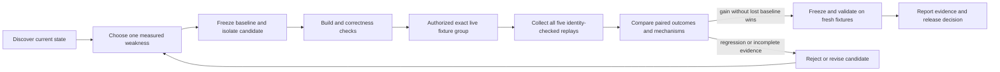

# Psi: original Battlecode harness design

**Implementation status:** the P0 project adapter, durable experiment records, existing controller integration, replay checks, fresh-fixture confirmation and event-driven job waiting are now implemented. See [the current workflow](BATTLECODE_WORKFLOW.md) for actual tool names and behaviour. The plan below is retained as the original design, including proposed future capabilities.

This plan targets `/Users/sebastianmiletic/Coding/Cambridge Battlecode 2026`. It describes capabilities and implementation priorities for Psi. It does not authorize an experiment, change a bot, queue a match or submit a version.

## Start with the workflow already in the project

Read-only inspection on 31 October 2026 found:

- The project README and `bots/vision-v6/README.md` identify frozen VisionV6 v248 as the incumbent. `bots/vision-v6/manifest.json` records exact source hashes. This is the checkout's documented baseline, not a fresh readback of platform selection.
- `tools/vision/README.md` and `docs/vision/V248_NEXT_EXECUTION.md` require local runs for correctness/diagnostics and exact server fixtures for strength decisions. Older material in `docs/history/TEAM_PROTOCOL.md` is historical and must not silently replace that newer workflow.
- `tools/vision/live_trial.py` already preserves historical opponents, maps and seats, queues an entire five-game group, serializes platform operations, restores the incumbent, reconciles jobs and reads back selection/active state. It deliberately avoids blind retries after ambiguous writes.
- `tools/vision/live_collect.py`, `live_report.py` and `live_ranked_audit.py` already perform collection, identity checks, paired reporting and ranked-exposure auditing.
- `tools/vision/freeze_candidate.py`, `tools/clone/decode.mjs`, `tools/clone/death_context.py` and `tools/clone/audit_combat.py` provide candidate and replay-analysis building blocks.
- The explicit local executable `~/.venvs/cambc400/bin/cambc --version` returned `cambc 4.0.0`. Engine compatibility and current platform state must still be refreshed at the start of an actual experiment. Do not assume plain `cambc` resolves to this executable.

Psi should integrate those tools rather than create another match queue or an alternate scoring protocol. This planning pass did not run builds, games, uploads, activation or Battlecode API calls.

## What the AI can access now

Use `/tools` in Psi to inspect the live tool definitions.

| Capability | Access today | Limits of the current implementation |
| --- | --- | --- |
| Inspect and edit code | `search`, `read`, `write`, `edit` | Exact-match edits; relevant nested instructions still need inspection |
| Shell, compilers, tests and scripts | `bash` | Full host access, without approval dialogs; installed tools determine availability |
| Long jobs | `bash`, `job` | Detached processes, persisted job metadata, log bounds, wait/status/stop; no reboot-resuming supervisor |
| Local sweeps | `benchmark` | Frozen artifact/input hashes, seeds, maps, both sides, bounded workers, resumable JSONL; does not prove live strength |
| Internet research | `search_web`, `fetch` | Extracted text, links, JSON, cached responses and artifacts; search can be blocked |
| JavaScript websites | `browser` | Separate installed Chromium-family browser, evaluation, screenshots; not a logged-in personal profile |
| Persistent work | Session journal, `checkpoint`, `/resume`, `/compact` | Context summaries plus complete evidence on disk; completion still depends on model judgment |
| Provider/account choice | `/accounts`, `/model`, `/effort`, `/summary-model` | Multiple named accounts per provider, provider-independent selections, pinned request credentials and account usage records |
| Installed Battlecode tools | Available through `bash` now | No dedicated first-class live-trial/replay workflow adapter yet |
| MCP and cooperating AI workers | Not first-class today | A CLI can be called through the shell, but that is not a managed worker/tool integration |

The model already has a broad enough tool set to work on this competition. The largest missing benefit is structured experiment orchestration and evidence validation, not additional general shell power.

## The target loop

Every transition needs a durable receipt. A process restart must reconstruct the current phase without repeating an upload or creating a second match group.

### 1. Discover and freeze

Read the project README, current execution plan, relevant instructions, frozen manifest, SDK/engine facts and the scoped objective. For an authorized live objective, read current active/selected/pinned fields and match quota before mutations. Record the exact executable/version, baseline version, source/build/archive hashes, map/opponent identities, output directory and authorization scope.

Completion condition: a validated experiment manifest, not a conversational assertion that the baseline was frozen.

### 2. Choose a measurable hypothesis

Use replay evidence to select one mechanism and write its expected exposure and success criterion before editing code. The current execution plan suggests route valuation, capture reward per elapsed round, allied follow-up after stuns, carrier losses and startup/fuel behavior as distinct measurements. These are starting hypotheses, not verified fixes.

Measure actual actions, counters, path obstacles, cooldowns and champion/roster exposure. Do not use a bot name as proof that a mechanism ran. Keep clone-fidelity metrics separate from win rate.

Completion condition: hypothesis, measurement script, discovery fixtures, regression controls and a preselected confirmation set.

### 3. Isolate, build and check correctness

Create an isolated candidate directory or worktree. Preserve `bots/vision-v6` and its manifest. Build with the pinned toolchain, run the relevant ordinary/instrumented parity checks, detect illegal moves, crashes, exceptions and fuel exhaustion, and hash the artifact that will actually be tested.

Keep diagnostics separate from candidate strength. Instrumentation can change fuel behavior, so marker and instrumentation parity need explicit checks. Local wins must not qualify a candidate for this project's live-strength gate.

Completion condition: exact candidate identity, successful build, required correctness/parity evidence and unchanged incumbent fingerprints.

### 4. Run an exact live transaction only within the task's scope

Wrap the existing controller rather than reimplement selection/rollback. Preserve the historical opponent, every map UUID and our side, including old incumbent wins. Use the project's platform lock. Persist request intent and receipts before advancing. Reconcile ambiguous upload/create outcomes before any retry.

A complete group is five finished games with the candidate marker verified in all five own-team replays. A selector acknowledgement is not an active rollback. Preserve the controller's restoration handling on interruption, including fallback preparation and final stable readback.

The platform's ranked and unranked selector is shared. The workflow can measure and reduce experimental exposure; it cannot claim a private ranked sandbox. Match creation, quota use and submission are separate actions and must match the user's actual task. Full-auto execution should carry out that scope without repeated confirmation dialogs; planning-only tasks remain read-only.

Completion condition: receipts, all jobs reconciled, verified replay identities, restored baseline state and exposure audit for the checked interval.

### 5. Compare outcomes and diagnose causes

Use `live_report.py` to pair against the exact controls. Report recovered losses, every lost incumbent win, map family/side/opponent cells, runtime faults and actual mechanism exposure. Analyze replay events with typed actor IDs and reconciled engine counters. Record hashes and artifact paths for every conclusion.

Repeated deterministic fixtures are reproductions, not independent sample size. Finite panels do not establish future ranked non-regression. Do not substitute lower deaths, closer losing banks or local gains for live wins.

Completion condition: a structured decision with evidence class, complete denominator, all regressions and unresolved uncertainty.

### 6. Confirm, retain or release

A discovery candidate needs a real gain without losing an incumbent win, then confirmation against fresh, preselected archived-opponent/map/side fixtures and preserved winning controls. Freeze the exact artifact between discovery and confirmation. Reject incomplete or contradictory evidence and retain the incumbent.

Submitting or activating a successor should be a separately scoped release objective. Verify its receipt, artifact identity and platform readback. A planning or development objective must not silently become a release.

## Build priorities for Psi

### P0: experiment reliability

1. **First-class Battlecode project adapter.** Discover the current baseline and tools automatically; surface a tool inventory and project-specific instructions. Keep the pinned CLI path and evidence policy in a local project profile, not model guesswork.
2. **Typed durable experiment state.** Store hypothesis, frozen inputs, phases, subprocess IDs, submission/match receipts, replay hashes, decisions and outstanding restoration in a schema-validated manifest. Require evidence for phase transitions and reconcile after a crash.
3. **Live controller integration.** Add tools such as `battlecode_inspect`, `battlecode_freeze`, `battlecode_correctness`, `battlecode_live_trial`, `battlecode_collect` and `battlecode_compare`. These names are proposals, not tools already exposed. Reuse the project's scripts and locks.
4. **Event-driven waiting.** Let a job or remote group wake the model on completion, failure or a meaningful milestone. Long waits should consume no inference tokens. Avoid one paid model call per game or per short poll.
5. **Structured evidence gates.** Mark generated/proxy/local/server/held-out evidence explicitly, reject missing markers or partial groups, verify immutable input hashes and include all regressions. Keep the newest project policy ahead of historical protocol files.

Acceptance: kill Psi during each phase in a simulated offline controller test; resume without duplicate side effects, lost identities or a false completion report. Exercise rollback using the project's offline injected-command fixtures before any live integration test.

### P1: efficiency and useful research

6. **Artifact and replay store.** Index source/artifact/replay hashes, engine version, opponent version, map, side, bank deltas, errors and mechanism metrics. Reuse immutable downloads and decoded facts. Query compact tables instead of repeatedly putting full logs in model context.
7. **Measured resource scheduler.** Separate CPU-heavy builds/replay decoding, API requests and model calls. Bound worker count, memory, disk growth, competition quota and request rate independently. Preserve raw evidence referenced by accepted decisions.
8. **Model roles and account routing.** Use a capable planner for strategy decisions, a cheaper model for routine extraction/summaries and deterministic scripts for statistics. Keep stable prompts/cache keys. Track each named account independently. Pause on unavailable quota or a hard limit instead of silently treating a different account as the same budget.
9. **Hypothesis queue and stopping rules.** Rank experiments by expected information per game/token. Favor interventions that distinguish competing explanations. Stop on correctness failure, decisive regression, depleted scope budget or stalled progress; write a checkpoint with the next useful action.
10. **Fresh primary-source research.** Fetch official mechanics/patch notes, dated ladder snapshots and authorized replay data. Retain URLs, timestamps and engine compatibility. Refresh unstable facts before using them; do not train decisions on stale champion tables.

Acceptance: measure wall-clock time, model tokens, cache reads, game count, duplicate downloads and valid decisions on a fixed replay corpus. Demonstrate lower inference overhead without losing evidence or broadening claims.

### P2: optional extensions

11. Managed worker agents with isolated directories, strict task/output schemas, parent-owned budgets and a single owner of live state. Parallelize read-only research and replay processing first; do not let workers race on the shared selector.
12. MCP integrations for specific missing data sources, introduced only when a built-in tool or existing CLI is insufficient. Tool discovery should keep inactive schemas out of every prompt.
13. A process supervisor for restart after terminal loss/reboot, cancellation propagation and a visible heartbeat. Recovery must reconcile platform receipts before continuing.
14. Automated release packaging after a validated decision, with exact artifact/receipt/readback verification.

These extensions should follow the P0 evidence loop. More workers and tools are not automatically a better agent.

## Account usage semantics

The footer's second row shows the selected account's calls and tokens recorded by Psi across sessions. Inference requests pin the account before auth resolution, so switching accounts elsewhere cannot charge a completed request to the wrong local usage record. Another account with the same name remains distinguishable by its ID in `/accounts`.

Provider-reported quota windows and API request/token rate windows can be captured from response metadata when available. Unsupported, missing or expired data must say unavailable. These are different from local token totals, subscription billing and activity from other clients. Do not infer a universal remaining-balance percentage from token counts. No credential or arbitrary response header is stored in the usage ledger.

References: [official OpenAI API rate-limit headers](https://developers.openai.com/api/docs/guides/rate-limits), [official Codex account rate-limit schema](https://learn.chatgpt.com/docs/app-server), [official Claude API response headers](https://platform.claude.com/docs/en/api/rate-limits).

## Recommended next implementation milestone

Implement the P0 adapter and a simulated end-to-end v248 experiment lifecycle. Use the existing offline `tools/vision/test_live_trial.py` tests as a reference contract. The milestone ends with a resumable, evidence-checked report produced from injected fixtures. Only a later explicitly scoped live experiment should spend competition quota or alter platform selection.
