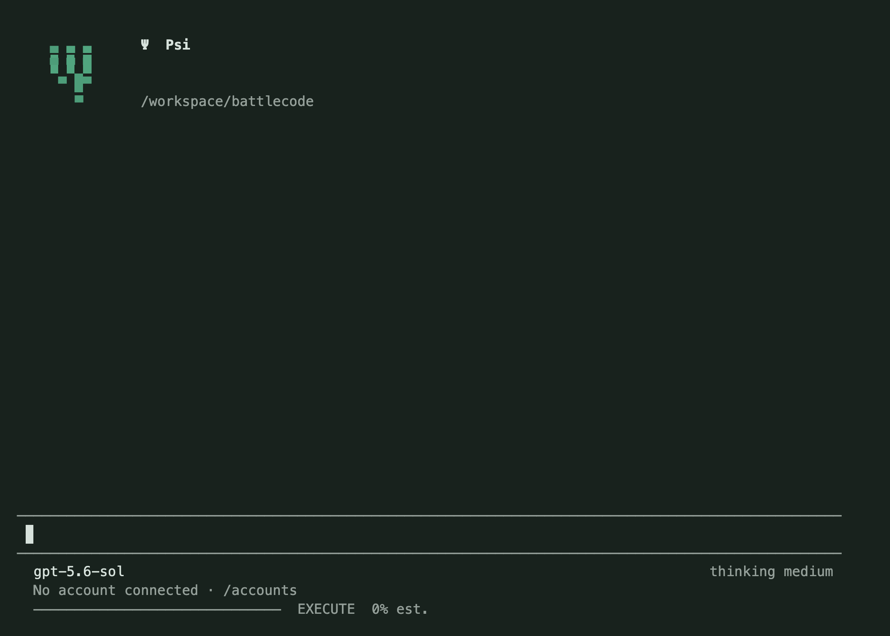
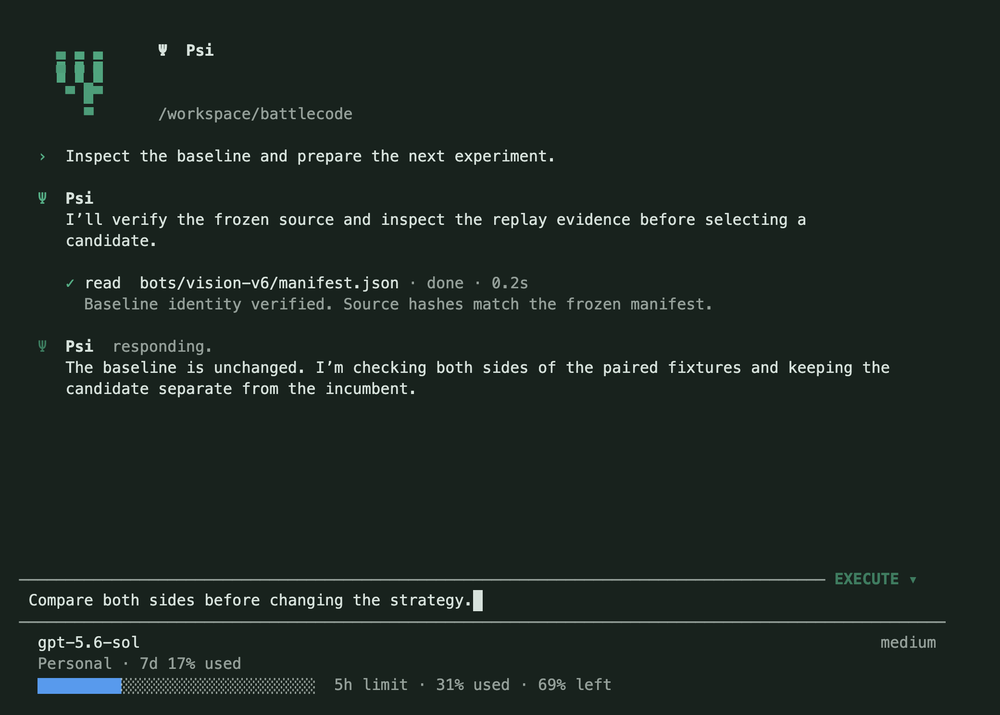
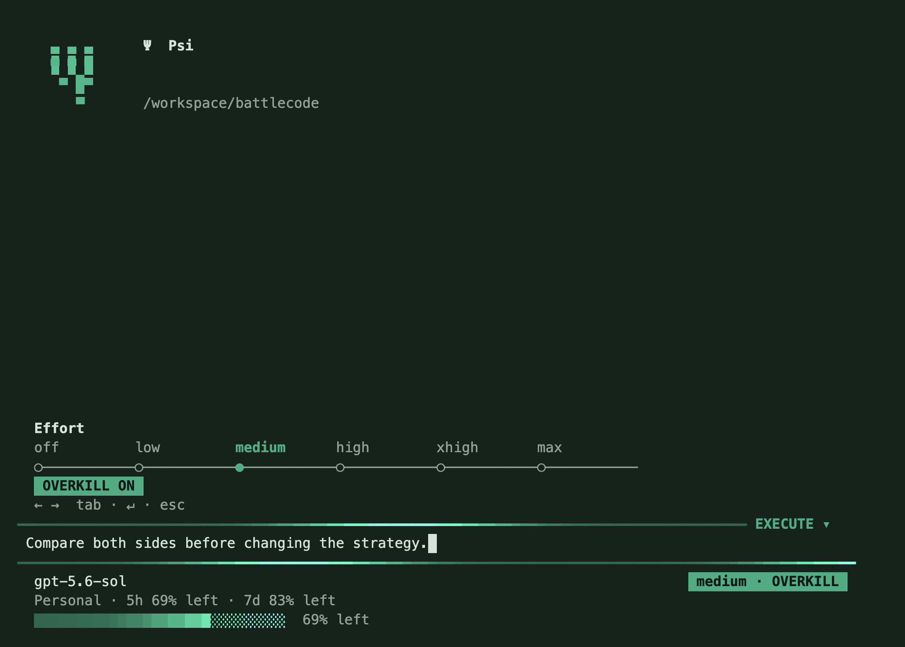
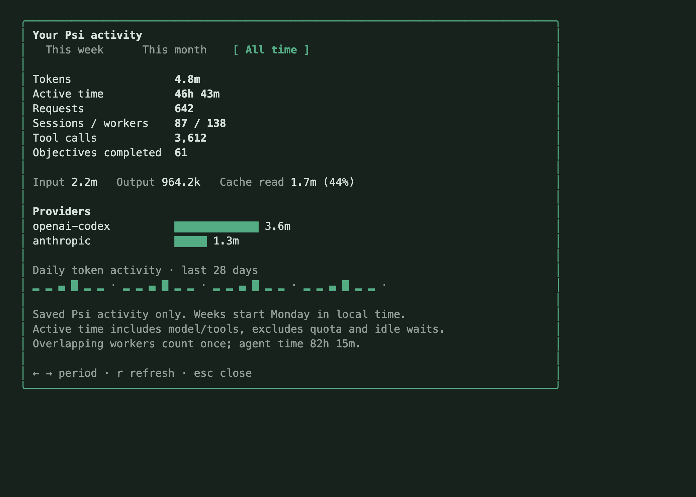
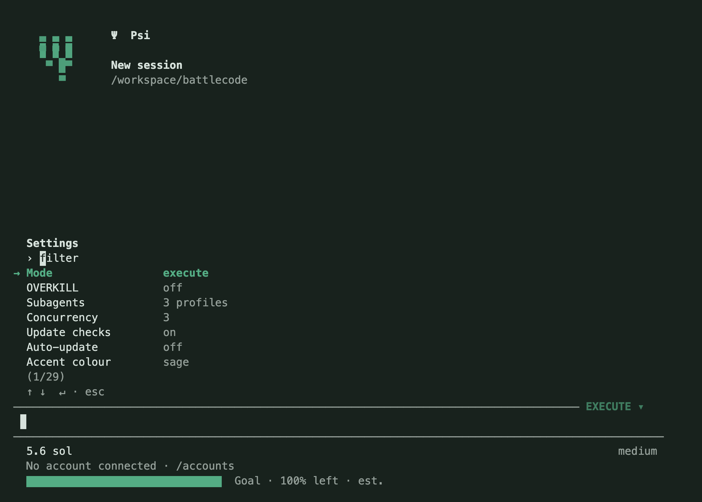
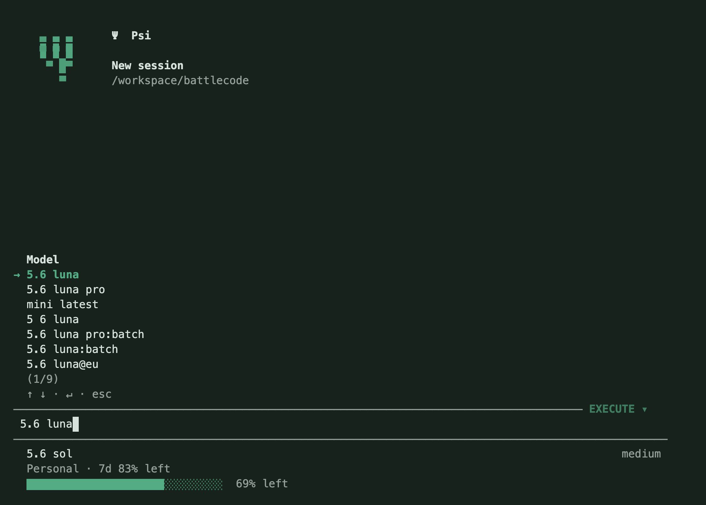
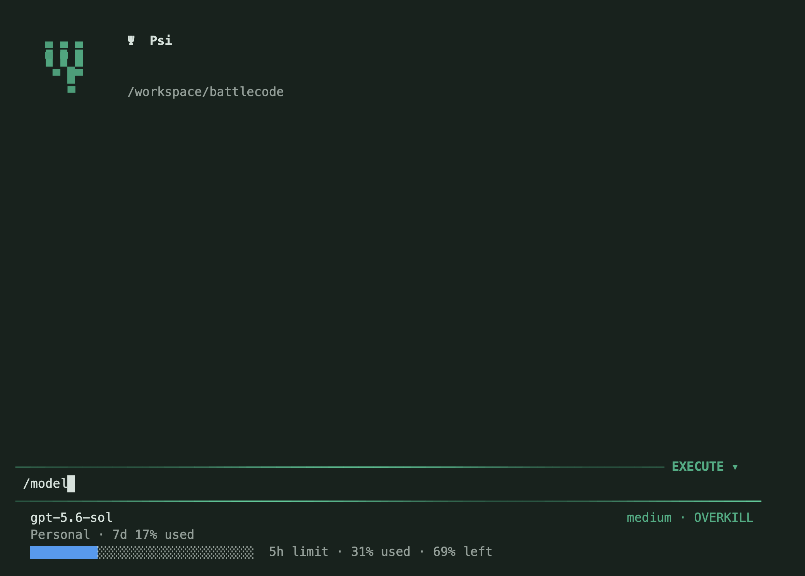

# Ψ Psi

<p></p>

**Lightweight AI harness made for long and intensive loops.**



A personal AI coding harness for long Battlecode development loops. A terminal UI, tools isolated to approved directories, persistent sessions, and a benchmark runner that spends no model tokens per game.

Built in JavaScript on Node.js with Pi's model transport and terminal renderer. No Electron, frontend build, local web server or bundled browser. The default model is `openai-codex/gpt-5.6-sol`; all supported providers remain selectable.

## Start

Download a release from [GitHub Releases](https://github.com/sebastianmiletic/Psi/releases/latest), or use the installer after installing Node.js 22.19+:

macOS and Linux:

```sh
curl -fsSL https://raw.githubusercontent.com/sebastianmiletic/Psi/main/scripts/install.sh | sh
```

Windows PowerShell:

```powershell
irm https://raw.githubusercontent.com/sebastianmiletic/Psi/main/scripts/install.ps1 | iex
```

The installer verifies the release archive's GitHub SHA-256 digest, installs pinned dependencies and creates a launcher. macOS/Linux use `~/.local/bin`; Windows uses `%USERPROFILE%\.psi\bin`. Add the printed directory to PATH. Node.js is a prerequisite, not bundled. Native Windows supports the terminal, file/research tools and model workers. For isolated shell/build tools on Windows, run Psi inside **WSL2 with bubblewrap**. Linux also requires bubblewrap (`sudo apt install bubblewrap` on Debian/Ubuntu); unsupported isolation disables shell tools rather than running unrestricted commands. macOS uses its built-in Seatbelt sandbox.

From source:

```sh
git clone https://github.com/sebastianmiletic/Psi.git
cd Psi
npm ci --ignore-scripts
npm start
```

The local `psi` launcher can be installed with `npm run install:local`. Then open any project:

```sh
psi -C "/Users/sebastianmiletic/Coding/Cambridge Battlecode 2026"
```

Use `/accounts` to connect an account, `/model` to choose a model, and type your task. The starting directory is granted automatically. Tools execute without approval prompts inside the approved directories; use `/directory <path>` to select a different workspace.

Requirements: Node.js 22.19 or newer, `rg` for file search, and your normal build/competition tools. Browser tools use an installed Chromium-family browser, including Brave on this Mac. No browser download is required. Set `PSI_CHROME_PATH` for another installation.

## Updates

Interactive startup checks the latest stable GitHub release in the background, at most once every six hours. An available update appears with `/update` and `psi update` commands. Offline checks stay quiet. `/settings` can disable checks or enable automatic installation; restart Psi after an update.

`psi update --check` shows the release metadata without installing. Managed installs download and verify the versioned archive, install dependencies in a new release directory, then atomically switch the launcher. Source checkouts verify the origin, refuse local changes, and fast-forward only to the release tag. Accounts, sessions and user settings stay under `~/.psi`.

## Directories, planning and OVERKILL

Psi grants the directory where the session starts. No AI tool can grant additional access. `/directory /path/to/project` selects the session workspace and replaces the previous directory grant. `/directory` alone shows the command syntax. File tools resolve symlinks before access, and shell processes inherit an OS boundary. System executables/runtime libraries are available read-only; Psi manages its own scratch files, session artifacts and experiment evidence. Provider credentials and the real HOME are excluded from tool environments. The isolated shell HOME is a private scratch directory, so CLIs needing existing personal credentials require deliberate setup within the permitted directories.

Click the mode control on the top input border, or press **Shift+Tab**, for **PLAN** mode. The model can inspect files/websites and record a plan, but cannot edit project files, run shell/build commands, evaluate arbitrary browser scripts or perform live transactions. It can use the conversation to request missing information. Switch back to **EXECUTE** to implement the agreed plan. A mode change during inference is enforced before the returned tool calls run.

Use `/model` to type a search in the main input bar. The list and footer show model names, such as **5.6 luna**, without provider prefixes. Arrows move through matching models, Enter selects and Escape restores the draft. Duplicate display names are collapsed, preferring the current provider and then connected providers. A provider-specific query or explicit `provider/model` route remains available when you need another endpoint.

Open `/effort` for a compact slider: **←/→** adjust effort, **Tab** stages the right-aligned **OVERKILL** toggle, **Enter** applies and **Escape** cancels. OVERKILL adds a flowing glow in your selected accent around the input bar. Disable Motion for a static accent. Use `/subagents` or the worker entry in `/settings` to set concurrency and edit each worker's name, job, model, thinking, plan/execute mode, request limit and budget independently. With OVERKILL enabled, submitting a prompt starts no workers. The main AI first understands the task, then uses `agent` to delegate useful independent assignments. Each spawn requires a distinct task name of one to five words, such as `Build replay viewer` or `Fix fixture parser`. Missing, generic, overlong and duplicate names are rejected. Workers can implement, debug, build, benchmark, research or do any other assigned task within their directories and mode. Omit `profile` for a general worker on the main model, or select a preset for model, effort and limits. Profile names and job templates do not bind the child to a role. The AI may explicitly choose plan or execute mode; a plan-mode parent always forces read-only children. New installations start with general-purpose worker presets; existing custom presets remain available.

Worker rows below the usage bar show task names, model, active tool/response state and elapsed time. Finished workers disappear automatically; their records and results stay available in `/subagents`. At most three rows are shown; extra active workers are counted and `/subagents` exposes all runs. Completion uses filesystem events rather than inference polling. Reports are delivered at safe model boundaries and must be reviewed before the parent finishes. Interrupted parents can recover reports and deduplicated token receipts from saved journals. Double Escape stops the parent and workers.

Workers inherit the approved directories, use separate durable model sessions, and cannot create nested workers. A plan-mode parent always forces read-only workers. The AI can spawn, send follow-ups, inspect, await and stop them through `agent`; completed workers can resume for follow-up tasks. Returned worker usage is included exactly once in parent session accounting. Per-worker budgets are capped to a share of the parent's remaining configured budget when a worker starts.

Tool names, brief result previews, model updates and worker lifecycle events appear in the conversation. The mode control sits at the right edge of the top input border, leaving drafts and slash commands at full width. Mode changes stay out of the chat. The solid accent-coloured bottom bar shows **remaining** capacity: 100% is unused, 0% is exhausted. Only the reported weekly percentage stays beside the account name; the meter prioritizes five-hour quota. With no quota, the bar shows explicitly estimated goal work remaining. This percentage is not an independently measured guarantee of goal achievement. A verified loop finish still requires evidence.

## Providers and accounts

The current bundled catalog registers **228 provider adapters and 7,068 tool-capable model entries**. This includes native transports plus compatible API endpoints from the models.dev snapshot. Counts can change when the catalog is updated. Individual third-party endpoints have not all been tested with live credentials.

- Codex/OpenAI, Claude/Anthropic and several other native providers offer their supported sign-in flow.
- Other providers accept API keys or their documented environment variables.
- Store multiple named accounts per provider. `/accounts` directly exposes **Login new account**, **Switch accounts**, and **Remove account**. The switch list includes every saved provider/account.
- Active accounts are selected independently per provider. Switching an account also selects that provider's matching model, or its first model if there is no match.
- OAuth refresh is serialized across Psi processes. Normal sign-ins stay in Psi's own account store. Explicitly imported Pi accounts link to the existing source and share its refresh lock, so rotating tokens remain synchronized without changing Pi's active account.
- `psi provider add` configures a custom OpenAI Chat Completions, Responses or Anthropic Messages endpoint. Local servers can use no-key mode. Multiple accounts still work for custom endpoints.

Credentials and session files live under `~/.psi`, with private directory permissions and credential files set to mode `0600`. Credentials are stored as local JSON rather than the macOS Keychain. `PSI_HOME` selects another location, useful for testing. Never commit that folder.

To reuse existing Pi Codex logins without signing in again:

```sh
psi accounts import-pi --account "First account" --account "Second account"
```

Imports are idempotent and preserve other accounts and metadata. Imported credentials are private, and Psi refreshes them under Pi's own file lock. Removing a Psi account does not remove the original Pi account.

For automated API-key setup, pass the environment variable name rather than a secret in shell history:

```sh
psi accounts add --provider anthropic --name Personal --key-env ANTHROPIC_API_KEY
psi accounts list
psi providers
psi models codex
psi doctor
```

For a local server:

```sh
psi provider add --id local --url http://localhost:8000/v1 --model my-model --keyless
psi -m local/my-model --effort off
```

Custom endpoint prices default to unknown. Use `/settings` → **API rates** to configure USD per million input/output/cache tokens. A missing price is shown as unavailable, rather than a free session.

## Terminal commands

| Command | Purpose |
| --- | --- |
| `/logo` | Open the rotating 3D Psi logo |
| `/model [provider/model or search]` | Search and choose a model |
| `/effort [level]` | Choose a model-supported reasoning effort |
| `/accounts` | Login, switch or remove accounts |
| `/directory <path>` | Select the working directory |
| `/subagents` | Configure worker presets, independent models, thinking and limits |
| `/update` | Install the latest GitHub release |
| `/settings` | Searchable settings UI for appearance, accounts, models, limits and execution |
| `/loop [objective]` | Ask for a goal, then work until verified completion or user stop |
| `/project` | Inspect the documented baseline and existing Battlecode controllers |
| `/experiments [id]` | List durable experiments or reconcile one experiment |
| `/usage` | Active account usage and provider-reported limits |
| `/reset` | Reset times, banked resets and provider Usage access |
| `/stats` | Tabbed week, month and all-time tokens, active time and activity |
| `/tools` | List the actual tools available to the AI |
| `/cost` | Usage, cache reads and estimated cost |
| `/compact` | Summarize older context while preserving the full journal |
| `/profile battlecode\|general` | Change system guidance |
| `/name [title]` | Rename the current session, or prompt for a title |
| `/new` | Start a fresh session |
| `/resume [id]` | Search saved sessions |
| `/reload` · `/refresh` | Reload settings, accounts, providers and tools |
| `/export [path]` | Export the current session context as Markdown |
| `/status`, `/help`, `/quit` | Inspect state, see commands or exit |

The header shows the chat name above its saved working directory. Both survive reopening the session, regardless of the shell directory. Long paths shorten from the left to retain the project name. First prompts seed a title immediately; the model can refine it once through `session_title` during its normal work. `/name` locks a user title permanently against automatic changes.

The prompt stays pinned to the bottom of the terminal while the conversation scrolls above it. Its footer shows the model on the left and the effort value (such as `medium`) aligned to the right, without a provider label or “thinking” prefix. The next row shows the selected account: subscription accounts display only the weekly window as percent left; metered API accounts display the current session cost. No provider label appears in either footer row.

Click the compact shaded Ψ mark to expand it into a shaded, rotating 3D mesh. Click again or press Escape to return to your unchanged prompt. `/logo` provides the same interaction from the keyboard. The 3D animation renders only while open and adds no dependencies.

In `/model`, `/accounts`, Switch accounts and Remove account, type searches into the main composer. Search text is never added to conversation history, queued or sent to inference; Enter selects a row and Escape restores the previous draft. Account rows show reported reset countdowns, such as `5h 1h 30m · week 2d 4h · resets 2`. Missing windows and API plans omit this metadata; unavailable reports are marked. Cached rows appear immediately, then at most two read-only provider refreshes run concurrently and cancel on close.

Type to filter pickers, use arrows to navigate and Enter to select. Tab completes slash commands and paths. Shift+Enter creates a newline. The clickable mode control sits on the input border without shifting draft text or slash commands. One Escape closes a submenu. Escape twice within 600 ms stops the current run. Shift+Tab toggles plan/execute mode. Ctrl+C cancels a prompt or run and exits when idle. A message entered during a run is saved and queued after the next tool boundary. Remaining stale calls in that response are skipped with recorded outcomes before the correction reaches the model.

Stopping the AI also signals its subagents. Standalone detached jobs can continue; inspect them with `psi jobs` and terminate them with `psi jobs stop <id>`. Revoking a directory stops active session jobs before changing the allowlist. Live-controller cleanup can take several minutes.

Messages use a brief eased send marker, followed by clean Markdown responses with an inline bullet and aligned continuation lines. There is no repeated assistant-name heading or streaming-phase label above each response. The live Thinking/Working indicator sits above the composer and disappears after work stops.

Consecutive reads/searches/fetches form a compact **Exploring / Explored** group. Commands show **Running / Ran** with indented output; edit previews show removed/added text. Failures, nonzero exit codes, background job identities and stopped outcomes remain explicit. **Ctrl+T** toggles inline tool details without another model call. Compact output is bounded; expanded output remains a preview, with full journal/artifact evidence on disk. Disable **Motion** in Settings for static indicators. OVERKILL retains its slower flowing accent.



## Activity statistics

`/stats` opens a compact bottom panel with **This week**, **This month** and **All time** tabs. Use arrows or Tab to change periods, **r** to refresh and Escape to close. It shows tokens, model requests, active time, sessions/workers, tool calls, completed objectives, input/output/cache usage, provider distribution and a calendar heatmap. The header stays visible above every menu.

Statistics come from saved **Psi** journals, including existing sessions. They do not include work performed directly in Pi, Codex or Claude Code. Weeks start Monday and months use calendar boundaries in your local timezone. Worker receipts are deduplicated; overlapping work counts once as active time, while summed agent time is shown separately. Quota/idle waits are excluded. Interrupted sessions count only observed activity, so historical time can be a lower bound. Undated legacy worker copies count only toward all-time totals when their original journal is missing. Deleting a saved session removes its statistics.

An incremental private cache stores counters and timestamps, without copying prompts, messages or credentials. Opening statistics performs no model requests. See [feature gaps compared with Pi and Codex](PARITY.md).





## Usage and multiple accounts

Use `/accounts` → **Login new account** repeatedly to add any number of named accounts, including several from the same provider. Saved credentials are separate; connecting another account does not overwrite the first. Use **Switch accounts** to select from the flat cross-provider list. Rows show only provider and account name; use distinct names for clarity.

Subscription accounts show their provider-reported **7d** quota beside the account, and the **5h** quota in the bottom meter when supplied. `/reset` shows both reset times and countdowns. Codex and Claude OAuth accounts refresh on startup, before inference and periodically while the UI is open (default 120 seconds; minimum 60). Absent, unlimited or expired windows are omitted. `/usage` includes the snapshot timestamp and reset data. Polling uses the usage endpoint, not paid inference, and backs off when the service rate-limits it. These endpoints may be unavailable for some accounts or change independently of Psi; unavailable data is never inferred from tokens.

Metered API accounts show **session $…** below the prompt. Psi uses billed USD returned by a provider when available; otherwise it calculates cost from actual returned token usage at the configured model rates. Unknown pricing shows **cost unavailable**. This is not an invoice guarantee: provider pricing tiers, discounts and reporting can differ. The session total includes metered requests across accounts/models and survives resume; `/new` starts a fresh total. Subscription activity is excluded from that monetary total.

Enable **Account switching** in `/settings` to move between saved accounts of the same provider on exhaustion or authentication failure. You can set a reported usage threshold. **Fallback models** is an explicit ordered list of `provider/model` routes; an empty list keeps the current provider. Switching is off by default. If every eligible account is unavailable, a goal waits and rechecks until an account recovers, settings change or the user stops it. Accounts remain pinned per request; switching cannot mix credentials or usage attribution. Local per-account request/token counters live in `~/.psi/usage.json` and cover Psi activity only.

## Settings

`/settings` opens a searchable keyboard UI. Type to filter, use arrows and Enter to choose, and Escape to go back. Settings persist under `~/.psi/config.json`.

- Sage, cyan, blue, violet, rose or amber accents, plus custom hex/OKLCH colours.
- Logo visibility, Motion and account usage visibility.
- Automatic account switching, threshold, explicit fallback models and usage refresh interval.
- Main/compaction model, thinking, output tokens, prompt-cache retention and tool preview size.
- Read concurrency, loop retry delay, budget/request limits, API prices, Battlecode CLI and debug logging.

Appearance changes apply immediately. Model/execution changes during inference apply at the next boundary, preserving the in-flight request. A waiting loop wakes when its settings change.



## Battlecode project adapter

Psi now integrates the existing Vision controller in `/Users/sebastianmiletic/Coding/Cambridge Battlecode 2026`. `/project` verifies the README/manifest baseline and source hashes without contacting the platform. The adapter exposes tools only in a recognized Battlecode workspace with the Battlecode profile selected.

A durable experiment isolates the candidate, freezes source and WASM identity, runs local correctness commands, invokes the existing `live_trial.py`/`live_collect.py`/`live_report.py`, and verifies complete replay-backed discovery and preselected fresh confirmation panels. Live intents and receipts are persisted before advancing. Unknown live outcomes require reconciliation rather than duplicate creation. Live workers allow the controller to restore the incumbent before cancellation completes.

Decisions require exact map/opponent/seat pairing, all five games, matching engine and outcomes, archive hashes, the candidate marker in actual own-team replay stdout, no recorded runtime faults, and incumbent restoration readbacks. Collected evidence is hashed when the worker commits it and checked again before deciding. A candidate must preserve every incumbent win and gain a win in discovery and across the fresh confirmation set. Confirmation reuses the exact submitted candidate version. Passing yields **qualified_for_review**, not automatic release or a claim of broad ranked superiority.

See the [implemented workflow and tool examples](BATTLECODE_WORKFLOW.md), and the [original design rationale](BATTLECODE_HARNESS_PLAN.md). Building this adapter did not queue real competition games or change the active bot.

## Long, low-overhead loops

```sh
psi -C "/path/to/battlecode" \
  --loop "Freeze the baseline, find and validate an improvement, and save the evidence. Follow AGENTS.md and the competition protocol." \
  --budget 10 --max-steps 300
```

Headless operation:

```sh
psi -C /path/to/project -p "Build the bot, diagnose failures and fix them."
psi -C /path/to/project --continue -p "Continue the next experiment."
psi --resume SESSION_ID --json -p "Report pending work and continue."
```

`--json` emits event JSONL for automation. Use a process supervisor such as `tmux`, `launchd` or your existing runner to survive terminal loss or reboot. Detached benchmark jobs survive a Psi process exit; they do not survive a machine reboot or sleep as continuously running compute.

Psi's normal agent loop continues through tool calls. `/loop` without an argument asks for the objective. Autonomous goals continue after plain final responses, recoverable provider errors and stalls; `finish` requires a verified summary and existing evidence paths. Battlecode completion can additionally validate the experiment's fresh-fixture qualification.

A reached budget/request limit keeps the goal **waiting**, with no further inference until the limit changes or the run resumes. Exhausted accounts and temporary failures also wait and recover. Double Escape or Ctrl+C stops the run and preserves the unfinished goal; type another message or resume the saved session to continue it. Defaults impose no cost or request ceiling for the main model; workers have their own configurable request limits. A killed process or reboot requires restarting Psi and resuming the saved session; no harness can guarantee uninterrupted execution through host failure or independently prove every natural-language objective.

Efficiency mechanisms:

- Lazy provider SDK and browser loading. No idle animation timer when the logo view is closed and OVERKILL is off; subscription usage refresh runs at a bounded, configurable interval.
- Stable session identifiers and provider-supported prompt-cache hints.
- Configurable reasoning and output budgets; an optional cheaper compaction model.
- Bounded tool results with full text saved to artifact files.
- Parallel independent reads/fetches/searches, ordered writes and edits.
- Detached jobs, bounded logs, event-driven `job await`, and a resumable sweep runner instead of one model turn per match or queue poll.
- Automatic context compaction. Append-only journals preserve evidence; session loading streams the journal rather than reading it all into memory.
- A maximum of 100 visible transcript components, independent of the full disk journal.
- Bounded request retries with exponential backoff; goal-level recovery and optional account/model failover preserve long tasks.
- Writer locks, partial-journal recovery and explicit unknown outcomes for tools interrupted by a crash. Psi does not silently re-execute an uncertain side effect.

Budget reservation uses configured/catalog rates, not a provider billing guarantee. Before each request Psi reserves estimated input and maximum output cost against the budget in `/settings`; returned billed USD overrides the completed request total when supplied. Unknown/custom prices, tiered/long-context rates and provider accounting differences can affect accuracy. Defaults impose no cost or step ceiling. Choose limits appropriate to your account.

## Local benchmark sweeps

Copy [examples/benchmark.json](../examples/benchmark.json) into your project and adapt the command to the actual competition runner. Psi does not assume a particular Battlecode engine CLI.

```sh
psi -C /path/to/battlecode bench benchmark.json
```

The model can also invoke the `benchmark` tool with a manifest path. It starts a durable job and returns its ID, so it can continue other useful work and wait later.

A manifest provides:

- An **argv array**, not a shell template. Placeholders: `{candidate}`, `{name}`, `{seed}`, `{side}`, `{map}`, `{repeat}`, plus candidate-specific `params`.
- Candidates with distinct names and paths to frozen artifacts.
- Seeds, maps, sides (default `[0,1]`), repetitions and worker concurrency.
- Optional `inputs` to hash runner scripts, maps or configuration, plus version metadata.
- A stable output directory for resumability.

The runner records artifact SHA-256 values, exact commands, seeds/sides/maps, exit codes, elapsed times and individual log paths. Each match can print a final JSON object containing `"outcome": "win"`, `"loss"` or `"draw"`; other successful output is recorded as unscored. Nonzero exits and timeouts are errors, regardless of any claimed outcome in stdout.

Results are stored in `results.jsonl`, `sweep.json`, per-match logs, and `summary.json`. Re-running the same manifest/output skips recorded matches. Changing artifact or input hashes requires a new output directory. The final check marks results invalid if frozen inputs changed during the sweep. Records are local comparative evidence; they do not establish competitive promotion, ladder performance or actual submission.

## Tools

`read`, `write`, `edit`, `search`, `bash`, `benchmark`, `job`, `fetch`, `search_web`, `browser`, `checkpoint`, `progress`, `finish`. OVERKILL additionally exposes `agent`. Recognized Battlecode workspaces additionally expose `battlecode_inspect`, `battlecode_control`, `battlecode_experiment`, `battlecode_freeze`, `battlecode_correctness`, `battlecode_live_trial`, `battlecode_collect`, `battlecode_report` and `battlecode_decide`.

`fetch` handles HTML extraction, links, JSON/text, a short cache and full-response artifacts. `search_web` uses DuckDuckGo HTML and reports blocking/no-results errors explicitly. `browser` uses a separate ephemeral headless browser with JavaScript evaluation, links, screenshots and a persistent page for the running Psi process. It does not reuse your personal browser profile. Arbitrary installed CLIs, Python scripts, databases and download tools remain available through `bash`.

Ancestor `AGENTS.md` files are loaded for the selected workspace. The Battlecode profile asks the model to freeze baselines, separate local correctness/comparison from competition evidence, inspect failures/replays and retain checkpoints. It is guidance, not a guarantee of bot quality. A requested live trial can upload and temporarily select a candidate through the existing controller; final release remains a separate objective.

Operational debug logging is enabled by default, per the local development preferences. It records event types, model labels, retries, tool names, durations and errors, without recording raw provider payloads or credential values. Full conversation and tool content are stored in the separate private session journal. Use `--no-debug` to disable operational logging.

## Development

```sh
npm run verify
npm run catalog:sync
```

Tests use an isolated local OpenAI-compatible streaming server and temporary data folders. They cover real HTTP tool cycles, account isolation and refresh locking, costs/limits, retries, resume/crash recovery, process cancellation, website extraction, the installed browser, paired benchmark sweeps, bottom-pinned layout through terminal resizes, footer contents and account attribution, mouse-triggered 3D animation and timer cleanup. They also exercise persistent goal recovery, quota-aware account/model failover, settings changes during inference, and an entire offline Battlecode controller/collector/replay qualification workflow. They do not spend paid inference, sign into external accounts or queue real matches. The Codex path is also exercised by the real Harness-Bench subset described in [benchmark results](HARNESS_BENCH.md). Other provider login/usage paths and all third-party endpoints still need verification with their own accounts. See [verification details](VERIFICATION.md).

Transport and terminal rendering: [Pi](https://github.com/earendil-works/pi). Additional provider data: [models.dev](https://models.dev). Codex authentication reference: [official OpenAI documentation](https://developers.openai.com/codex/auth). Dependency licenses remain with their respective packages.

## Reload

`/reload` (also `/refresh`) reloads disk settings, provider/model registrations, accounts, tools and the UI configuration. It retains the session journal, allowed directories, queued messages, objectives and draft. Global disk settings take precedence over previous session settings. If inference is active, select **Reload** to stop it and rebuild, or cancel to continue uninterrupted. Reload does not start another model request; unfinished work stays saved. Detached standalone jobs remain managed by their existing job records. Installed source code changes still require a process restart.

The compaction model remains in `/settings`. Custom provider setup remains available through `psi provider add`. See [removed commands and recommendations](COMMAND_CHANGES.md).

## Account resets

See [Reset details](RESETS.md) for banked Codex resets, provider reset schedules, account selection, optional CLI setup and Claude’s web redemption flow. Budget, request and output ceilings remain in Settings; the context-summary route is labelled **Compaction model**.





## Session names

`/name My experiment` renames the current session. `/name` without an argument opens a title prompt. Names persist in the journal and session metadata, appear in `/resume` and session listings, and are included in exports. Naming does not clear context, goals, account data or files and works while inference is active. Escape cancels the prompt. Names are one line, up to 120 characters.

Use `/directory /path/to/project` to select a workspace inside the current chat, or `psi -C /path/to/project` at startup. Psi saves the selected path in the session, rebuilds tools against it and retains the conversation and replaces the previous workspace grant. Home-relative header paths use `~/`, for example `~/Coding/Psi`. Resuming a chat always restores its own saved workspace rather than the launch directory.

Completed substantive tasks automatically finish with a Markdown review: outcome, scope, findings or changes, verification, limitations, and useful next priorities. `finish` accepts the complete `report` so it can be displayed without another model request. Missing reports receive a bounded text-only recovery. Final reports are durable, restored on resume and included in exports. Plan mode also provides the actual plan after recording progress. Sending a new message scrolls to the bottom; interim updates respect manual scrolling.

Subscription usage refreshes every 15 seconds by default (5–30 seconds in Settings), and after responses or account changes. Provider-reported decimals are preserved to one decimal place. Cached or stale readings are labeled; absent subscription quotas show Usage unavailable rather than estimated goal progress. Retry-After/backoff is respected. Provider latency and rounded source values still limit how immediate the display can be. Polling consumes no model tokens.
