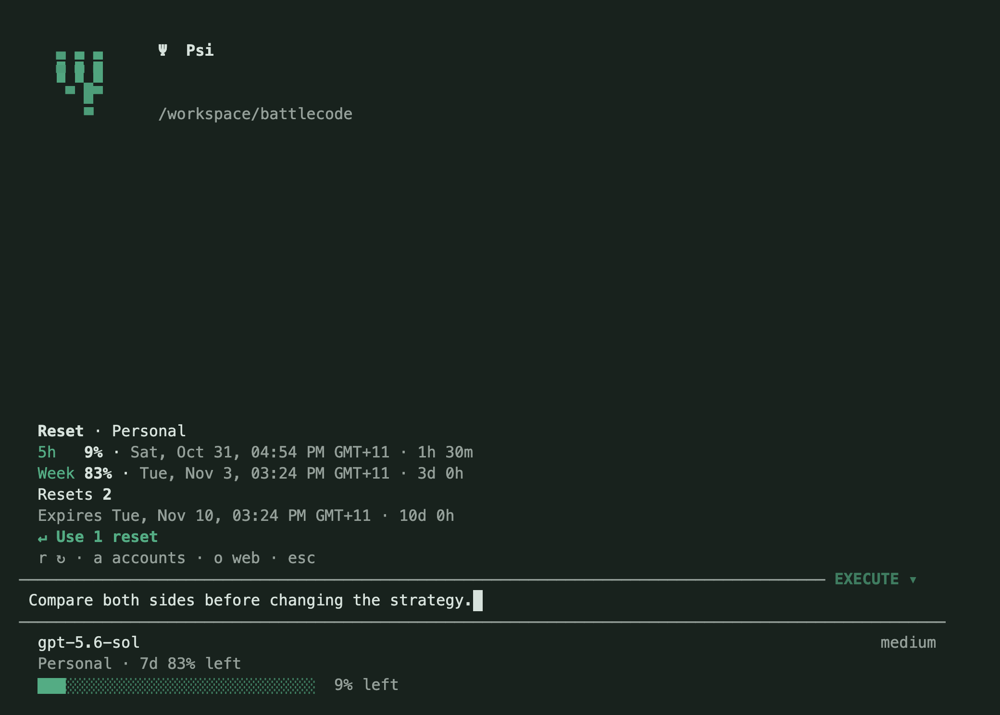

# Account resets

`/reset` opens a compact panel above the prompt. It shows provider-reported five-hour and weekly percentages, the next reset in local time, and a countdown. Windows that are absent or unlimited are not invented. Expired snapshots say **refresh due** until new data arrives.

- **r** refreshes account data.
- **a** chooses another saved account without switching the model's active account.
- **o** opens the provider's Usage page. Check that the browser is signed into the selected account.
- **Enter** selects a Codex banked reset; another Enter confirms its use.
- **Escape** closes the panel and cancels outstanding reads.

The footer shows only weekly quota beside the account name. The bottom accent meter still prefers five-hour quota, with a weekly fallback. Percentages mean capacity left: 100% is unused and 0% is exhausted. Budget, request ceilings and output tokens remain in Settings, alongside **Compaction model**.

## Codex

A current `codex` executable on PATH is required for direct banked-reset discovery and redemption. Set **Codex CLI path** in Settings if needed. No CLI process runs while the reset panel is closed. If the executable is missing or outdated, scheduled quota data still falls back to Psi's existing usage reader, and the panel offers the official Usage page.

Psi uses the documented Codex app-server account API. It verifies in-memory credential storage and the official service URL before sending credentials. Authentication is pinned to the selected Psi account and sent through stdin, never command arguments. It does not change the Codex CLI's saved login or require another browser sign-in. A provider response with a different account identity is rejected.

Only provider-reported available reset credits are redeemable. The count can be known even when individual credit details are unavailable. An unknown count is distinct from zero. Credit expiry is shown when reported. Redeeming uses the earned reset, not an API budget, chat-history reset or purchase of extra credits.

Each logical redemption is recorded privately before sending it, with an account-bound idempotency key. If its outcome is uncertain, **Retry pending reset** reuses that key across process restarts. A successful response is followed by a fresh limits read; Psi does not assume a new percentage. A saved successful reset is not automatically repeated. Other accounts and local token statistics are untouched. Reset redemption is a user command, not a tool exposed to the model or an automatic account-switch action.

The optional bridge is based on the [Codex app-server reset API](https://learn.chatgpt.com/docs/app-server) and [ephemeral credential storage](https://learn.chatgpt.com/docs/auth?surface=cli).

## Claude

Claude's official reset offers are redeemed in **Settings → Usage** on the web or in Claude Desktop. `/reset` shows scheduled reset times from the account usage response and offers **Open Claude Usage**. Psi does not claim a reset count that the OAuth usage endpoint has not reported, or call an undocumented redemption endpoint. After redemption in the browser, press **r** to refresh Psi.

See [Claude's limit-reset instructions](https://support.claude.com/en/articles/17007452-what-is-a-limit-reset). Other providers show only quota data and actions supported by their integration. API-key accounts do not get invented subscription resets.

## Validation

Fixture tests cover pinned account identity, unknown versus zero credits, another-account responses, durable retries after a lost redemption response, provider-confirmed recovery, unchanged other-account records, panel confirmation/cancellation and a real stdio subprocess. A read-only check of the installed Codex CLI successfully reported quota windows and reset-credit data, with the saved Codex login unchanged. No real reset was consumed during development.
